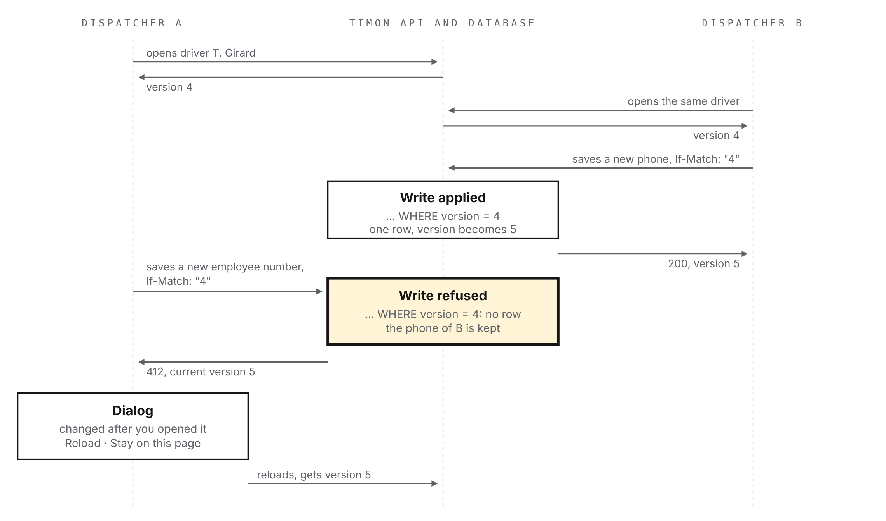

# TIMON-ADR-005: Concurrent edits

## Context

The exploratory test of 5 November found that two people editing the same record lose work without knowing it (T-006, issue #44). Dispatcher A opens a driver; dispatcher B opens the same driver, changes the phone number and saves; A changes the employee number and saves. A's form sends the whole record, so B's phone number is gone, and neither of them is told.

Today this needs two browser tabs. Once orders and the planning arrive, several dispatchers will work on the same fleet at the same time, and a lost change on a document or a unit is a lost compliance fact. The rule has to exist before the planning, not after.

The constraints:

- **Every write path.** The forms, the one-click actions (archive, restore, delete, set an end, change a driver) and the API itself, used later by integrations.
- **Both runtimes.** The same API runs on Node with PostgreSQL and in the demo's service worker on PGlite ([ADR-002](0002-target-architecture.md)): nothing that needs a server process of its own.
- **No users yet.** Authentication is out of scope for now, so the rule cannot rely on knowing who made the other change.
- **Records are edited whole.** A form shows a record and sends it back; that is the moment to check that nobody changed it in between.

The records concerned are the ones that can be changed after they are created: resources, documents, customers (with their contacts and usual sites), sites and units. Imports only create records and are not concerned.

<!-- pagebreak -->

## Options considered

What tells that a record changed:

| Marker | How it works | Limits |
| --- | --- | --- |
| **Version number** | An integer column, 1 at creation, plus one at every write | One more column per table |
| Date of last change | The existing `updated_at` column, compared on write | Two writes within the same clock tick look alike; depends on the server's clock; a value with microseconds rarely survives a round trip through JSON intact |
| Hash of the content | A digest of the record, computed on read and on write | Must cover every column, child rows included; costs a read before each write |

How the marker travels:

| Channel | How it works | Limits |
| --- | --- | --- |
| **`If-Match` header** | Reads return the version; every write sends `If-Match` with the version it started from; a stale one gets 412 Precondition Failed, a missing one 428 Precondition Required (RFC 9110, RFC 6585) | The web client must add the header to each write |
| A `version` field in the body | The version travels with the other fields | Deletes and one-click actions have no body; each schema repeats the field |

What the person sees when a change was made in between:

| Behaviour | Effect |
| --- | --- |
| Last write wins (today) | Silent loss of the other change |
| **Refuse and reload** | The save is refused; a dialog says the record changed since it was opened and offers to reload it; the person redoes their change on the current version |
| Merge field by field | Keeps both changes when they touch different fields; a wrong merge on a compliance record would be silent too |
| Lock on opening | Nobody else can edit while a record is open; needs users, a timeout and a way to break a forgotten lock |

## Decision

> **Decision:** every record that can be changed carries a `version` integer, 1 at creation, incremented by each write. Reads return it; every write to an existing record sends it in `If-Match`. The database applies the write only if the version still matches, in the same statement, and the API answers 412 with the current version when it does not, 428 when the header is missing. The screen refuses the save, says the record changed since it was opened and offers to reload it. No merge, no lock.
>
> **Why:** an integer cannot be confused by the clock or by two writes in the same instant, and the check costs nothing more than the write itself. A header works the same for a form, a delete and a one-click action, with the status codes HTTP defines for it. Refusing is the only behaviour that never loses a change silently and needs no users.

How it is applied:

- **One statement.** A write is `UPDATE … SET …, version = version + 1 WHERE id = $1 AND version = $2 RETURNING version`. No row returned means either no such record (404) or a stale version (412); a second read tells which. Deletes use the same `WHERE`.
- **Where it lives.** The repositories take the expected version; the use cases of `app` return a `stale` reason with the current version; `http` turns the header into that argument and the reason into 412. The domain does not change.
- **Child rows.** Contacts and usual sites are saved with their customer, under the customer's version. A document has its own version: adding one to a resource does not touch the resource's. A change of driver or trailer, and setting an end, check the version of the unit they start from.
- **The screen.** One handler in the web client for every write: on 412, a dialog in the product's language, "This record was changed after you opened it. Reload it to see the current version; your unsaved changes will be lost.", with *Reload* and *Stay on this page* (to copy what was typed before reloading). Reloading does not trigger the leave guard.
- **No forgotten route.** A test walks the OpenAPI document and fails if a write on an existing record does not declare `If-Match`.

## Consequences

- **What it makes simpler:** the planning can be built on records that never lose a write; integrations get the same protection through standard HTTP; two-tab tests become ordinary tests.
- **What it costs:** a `version` column and a migration on five tables; every write route and every repository update changes once; the web client keeps the version of what it shows.
- **What to watch:** new tables and routes must follow the rule, which the OpenAPI test enforces for routes; bulk writes added later (an import that updates, a planning action on many units) must check each version or say why they do not.
- **Out of scope here:** telling a person live that someone else is editing; field-by-field merge; locks; the history of who changed what, which needs authentication and gets its own decision.

{width=86%}
